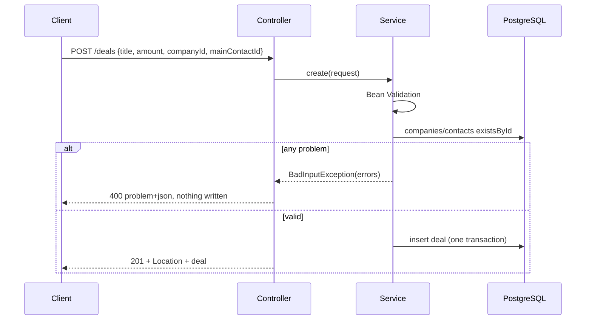

# 001 · Plan: CRM service baseline

## Approach

One Spring Boot application with a REST JSON API over PostgreSQL. The code is grouped by feature: `company`, `contact`, `deal`, plus a small `api` package for errors and paging. Each feature has an entity, a Spring Data JPA repository, a service that holds the rules, and a controller. Flyway owns the schema. The database itself clears references on delete (`ON DELETE SET NULL`), so no record can point at a deleted one.

Every acceptance criterion is proven by an HTTP-level integration test that runs the whole application against a real PostgreSQL started by Testcontainers. `./mvnw verify` runs them all, and a GitHub Actions workflow runs the same command on every push and pull request.

## Constitution check

| Article | How the plan complies |
| --- | --- |
| 1. API only | Every operation is a REST endpoint. Nothing needs a script or direct database access. |
| 2. Clear errors | One error format (RFC 9457 problem details plus a list of field errors). Validation runs before any write, and each write is one transaction, so a rejected request changes nothing. |
| 3. No dangling references | Foreign keys with `ON DELETE SET NULL` for contact → company, deal → company, and deal → main contact. Creates and updates check that referenced records exist. |
| 4. Easy to run | `./mvnw verify` on a laptop with Docker. Tests use PostgreSQL in a container, never an in-memory database. |
| 5. Small and conventional | Spring Boot starters, Flyway, the PostgreSQL driver, and springdoc. Each is a row in Decisions. No other infrastructure. |
| 6. Happy path first | Only what BACKLOG steps 1–6 need. No sorting options, search beyond names, or audit fields. |
| 7. Tests prove ACs | Every AC maps to a named test class below, or to a recorded manual check (AC-22 to AC-24). |
| 8. Green main | CI runs on every push and pull request from T2 on. Each task leaves `./mvnw verify` green. |
| 9. Small increments | Eight tasks, each about one commit with an `[001] Tn` message. |
| 10. Specs are living | Differences found while building go to Deviations below, and to the spec first if they change behavior. |
| 11. Decisions written down | See Decisions. The BACKLOG MVP items this plan settles are updated in place. |
| 12. Verify current docs | Versions checked on 2026-10-18 against Maven Central, GitHub releases, and the Spring Boot 4.1 and springdoc docs (Context7). They are listed under Design. |

## Design

### Versions

| Tool or library | Version | Notes |
| --- | --- | --- |
| Java | 25 (LTS) | `maven.compiler.release=25`. Works with the JDK 25 and 26 found locally. |
| Maven | 3.9.x via Maven Wrapper | `./mvnw`, so no local Maven is needed. |
| Spring Boot | 4.1.1 | Parent POM. Manages the versions below marked "Boot". |
| Spring Framework | 7.0.9 | Boot |
| Hibernate ORM | 7.4.5 | Boot, through `spring-boot-starter-data-jpa` |
| Flyway | 12.4.0 | Boot. Needs `flyway-database-postgresql` next to `spring-boot-starter-flyway`. |
| PostgreSQL JDBC driver | 42.7.13 | Boot |
| Testcontainers | 2.0.5 | Boot. 2.x works with Docker 29. |
| PostgreSQL image | `postgres:18-alpine` | Tests and the local run. |
| springdoc-openapi | 3.1.1 | `springdoc-openapi-starter-webmvc-api`. The 3.x line supports Boot 4; 3.1 is built on Boot 4.1. |
| GitHub Actions | `actions/checkout@v7`, `actions/setup-java@v6` | Temurin 25, Maven cache. |

### Dependencies

Main: `spring-boot-starter-webmvc`, `spring-boot-starter-validation`, `spring-boot-starter-data-jpa`, `spring-boot-starter-flyway`, `org.flywaydb:flyway-database-postgresql`, `org.postgresql:postgresql` (runtime), `springdoc-openapi-starter-webmvc-api`.

Test: `spring-boot-starter-test`, `spring-boot-starter-webmvc-test`, `spring-boot-testcontainers`, `org.testcontainers:testcontainers-junit-jupiter`, `org.testcontainers:testcontainers-postgresql`.

### Layout

```
pom.xml, mvnw, .mvn/
src/main/java/com/example/samplecrm/
  SampleCrmApplication.java
  api/        ApiExceptionHandler, FieldErrorItem, NotFoundException, BadInputException, PageResponse
  company/    Company, CompanyRepository, CompanyService, CompanyController, CompanyRequest, CompanyResponse
  contact/    Contact, ContactRepository, ContactService, ContactController, ContactRequest, ContactResponse
  deal/       Deal, DealRepository, DealService, DealController, DealRequest, DealResponse
src/main/resources/
  application.yml
  db/migration/V1__companies.sql, V2__contacts.sql, V3__deals.sql
src/test/java/com/example/samplecrm/
  TestcontainersConfiguration.java   @ServiceConnection PostgreSQLContainer bean
  TestSampleCrmApplication.java      runs the app locally against that container
  ApiTestBase.java                   @SpringBootTest(RANDOM_PORT), client, table cleanup
  *ApiTest.java                      one class per area, see Test strategy
.github/workflows/ci.yml
```

### Schema

```sql
companies (id bigint identity PK, name varchar(200) not null, website varchar(500))
contacts  (id bigint identity PK, first_name varchar(100) not null, last_name varchar(100) not null,
           email varchar(254) not null, phone varchar(50),
           company_id bigint references companies on delete set null)
deals     (id bigint identity PK, title varchar(200) not null, amount numeric(15,2) not null check (amount >= 0),
           company_id bigint references companies on delete set null,
           main_contact_id bigint references contacts on delete set null)
```

Indexes on `contacts.company_id`, `deals.company_id`, and `deals.main_contact_id`. `deals.company_id` is nullable in the database, because R18 clears it; the API requires it on create only.

Entities hold references as plain ids (`Long companyId`), not JPA associations. That keeps the database in charge of clearing references and avoids lazy loading.

### API

| Method and path | Does | Success |
| --- | --- | --- |
| `POST /companies` | Create (R1) | 201, `Location`, body |
| `GET /companies` | List all (R8) | 200, array |
| `GET /companies/{id}` | Read (R4) | 200 |
| `PUT /companies/{id}` | Replace fields (R5) | 200 |
| `DELETE /companies/{id}` | Delete (R6, R17, R18) | 204 |
| `POST /contacts` | Create (R2) | 201 |
| `GET /contacts?page=&size=&companyId=&name=` | Paged list (R10–R15) | 200, page object |
| `GET /contacts/{id}`, `PUT`, `DELETE` | Read, replace, delete (R4–R6, R19) | 200, 200, 204 |
| `POST /deals` | Create (R3) | 201 |
| `GET /deals?companyId=` | List all or one company's (R9) | 200, array |
| `GET /deals/{id}`, `PUT`, `DELETE` | Read, replace, delete (R4–R6) | 200, 200, 204 |
| `GET /v3/api-docs` | OpenAPI 3 description (R20) | 200, JSON |

Bodies (JSON, camelCase):

- Company: `{ "name", "website" }`. Response adds `id`.
- Contact: `{ "firstName", "lastName", "email", "phone", "companyId" }`. Response adds `id`.
- Deal: `{ "title", "amount", "companyId", "mainContactId" }`. `amount` is a decimal number with at most 2 decimals. Response adds `id`.
- Contact page: `{ "items": [...], "page": 1, "size": 20, "total": 25 }`.

Field rules: required fields must be present and not blank. Lengths match the schema. `email` must be a well-formed address (`@Email`). `amount` must be 0 or more, with at most 13 digits before the point and 2 after. `companyId` is required when a deal is created, optional on deal update and on contacts. Any `companyId` or `mainContactId` sent must exist.

### Errors

All errors use `application/problem+json`:

```json
{ "type": "about:blank", "title": "Bad Request", "status": 400,
  "detail": "The request has invalid fields.",
  "errors": [ { "field": "email", "message": "must be a well-formed email address" } ] }
```

- 400 for bad input: field errors on bodies (R16), invalid paging parameters (R12, `field` is the parameter name), unreadable JSON or wrong types (one error naming the field when it is known).
- 404 for a record that does not exist (R7), with a `detail` such as "Company 42 was not found". No `errors` list.

Validation flow for create and update: the service validates the request with the Bean Validation `Validator`, then checks each referenced id with `existsById`, collects every problem, and throws `BadInputException` with the full list. Doing both in one place means a request with a missing field and an unknown company gets both errors (R16 "every field"). Paging parameters use `@Min`/`@Max` on controller parameters, handled by Spring's built-in method validation.

### Key flows



Deleting a company or contact is a single `DELETE`. PostgreSQL sets the matching `company_id` or `main_contact_id` to null in the same transaction.

The contact list uses a JPA `Specification` built from the optional `companyId` and `name` filters (`lower(first_name) like %text%` or the same on `last_name`), with `PageRequest.of(page - 1, size, Sort.by("id"))`. Sorting by id gives a stable order (R10). Asking past the last page returns an empty `items` list and the real `total` (R15).

### Local run

`./mvnw spring-boot:test-run` starts the app with `TestSampleCrmApplication`, which uses the same Testcontainers PostgreSQL as the tests. Outside of that, `application.yml` reads `DB_URL`, `DB_USERNAME`, and `DB_PASSWORD` with defaults for `localhost:5432/samplecrm`.

## Requirement coverage

| Requirement | Covered by |
| --- | --- |
| R1 | `POST /companies`, `CompanyService.create`, `companies` table |
| R2 | `POST /contacts`, `ContactService.create`, `contacts` table |
| R3 | `POST /deals`, `DealService.create`, `deals` table |
| R4 | `GET /{type}/{id}` on each controller |
| R5 | `PUT /{type}/{id}`, full replacement; deal update allows no `companyId` |
| R6 | `DELETE /{type}/{id}` |
| R7 | `NotFoundException` → 404 from each service's read, update, and delete; checked before any write |
| R8 | `GET /companies` |
| R9 | `GET /deals?companyId=` |
| R10 | `GET /contacts?page=&size=`, `PageResponse`, sort by id |
| R11 | Defaults `page=1`, `size=20` on the controller parameters |
| R12 | `@Min(1)` on page, `@Min(1) @Max(100)` on size, method validation → 400 |
| R13 | `companyId` filter in the contact `Specification` |
| R14 | `name` filter, case-insensitive contains on first or last name |
| R15 | Spring Data page past the end: empty content, real total |
| R16 | Bean Validation + reference checks in each service, `BadInputException` → 400 with every field error |
| R17 | `contacts.company_id ... on delete set null` |
| R18 | `deals.company_id ... on delete set null`; `companyId` required on create only |
| R19 | `deals.main_contact_id ... on delete set null` |
| R20 | springdoc at `/v3/api-docs` |
| R21 | `./mvnw verify` with Testcontainers PostgreSQL |
| R22 | `.github/workflows/ci.yml` on `push` and `pull_request` |
| R23 | `git tag baseline` on the verified `main` commit, done in `/sdd-verify` |

## Decisions

| # | Decision | Alternatives | Why |
| --- | --- | --- | --- |
| D1 | Maven with the Maven Wrapper | Gradle | Maven is installed locally, Gradle is not. The wrapper pins the version for CI. Plain XML suits a small project. |
| D2 | Java 25 | Java 21; Java 26 | 25 is the current LTS and is installed. 26 is not LTS. |
| D3 | Spring Boot 4.1.1 | 4.2.0 milestones; 3.5.x | Latest stable release. Milestones are not stable; 3.5 is the older line. |
| D4 | Spring Data JPA with plain id references | Spring Data JDBC; `JdbcClient` with hand-written SQL | JPA is the most common choice and gives paging and `Specification` filters for free. Plain ids keep the database in charge of clearing references. |
| D5 | Flyway for the schema | Hibernate `ddl-auto`; Liquibase | Versioned SQL that later specs can extend. Flyway is the simpler of the two tools. `ddl-auto` cannot express `ON DELETE SET NULL` reliably. |
| D6 | References cleared by `ON DELETE SET NULL` foreign keys | Clearing them in service code; refusing the delete | The database guarantees Article 3 even for concurrent requests. The spec chose "clear", not "refuse". Settles BACKLOG "Deleting referenced records". |
| D7 | Errors as RFC 9457 problem details with an `errors` list of `{field, message}` | A custom error object | Spring has `ProblemDetail` built in, and it is a standard. Settles BACKLOG "Error responses". |
| D8 | Validate in the service with `Validator` plus reference checks, then throw one exception | `@Valid` on controller arguments | `@Valid` stops before the reference checks, so a request with a missing field and an unknown company would name only one problem. R16 asks for every field. |
| D9 | Ids are `bigint` identity values | UUIDs | Simpler and enough for one service. Nothing in the spec needs ids that cannot be guessed. |
| D10 | Contact paging with `page` from 1, `size` 1–100 (default 20), `items/page/size/total` response, sorted by id | Offset and limit; cursor paging | Matches R10–R12 directly. Sorting by id is stable and cheap. Settles BACKLOG "Contact list". |
| D11 | springdoc-openapi 3.1.1, JSON at `/v3/api-docs`, without Swagger UI | Swagger UI starter; a hand-written OpenAPI file | Generated from the code, so it cannot drift. The UI is not needed (no UI is a priority) and adds a dependency. Settles BACKLOG "API description". |
| D12 | Tests are HTTP-level `@SpringBootTest(RANDOM_PORT)` tests against one shared Testcontainers PostgreSQL, tables truncated before each test | Mock MVC slices with mocked repositories; one container per class | Proves each AC end to end against the real database. Sharing the container through Spring's context cache keeps the build fast. |
| D13 | GitHub Actions on every `push` and `pull_request`, Ubuntu runner, `./mvnw -B verify` | Only on `main` | R22 covers every pushed commit. Ubuntu runners have Docker for Testcontainers. Settles BACKLOG "CI". |
| D14 | Local run with `./mvnw spring-boot:test-run` and Testcontainers | A `compose.yaml` with PostgreSQL | No extra file or tool to keep in sync, and it uses the same database setup as the tests. |
| D15 | Field length limits: names and titles 200, first and last names 100, email 254, phone 50, website 500 | Unlimited `text` columns | R16 needs a "too long" rule. These fit real data, and 254 is the practical email maximum. |

## Test strategy

All automated tests are integration tests in `src/test/java/com/example/samplecrm/`. They call the API over HTTP and run against PostgreSQL in a container.

| Acceptance criterion | Verified by (unit, integration, e2e, manual) |
| --- | --- |
| AC-1 | Integration: `CompanyApiTest.createAndRead` |
| AC-2 | Integration: `ContactApiTest.createAtCompanyAndRead` |
| AC-3 | Integration: `ContactApiTest.createWithoutCompany` |
| AC-4 | Integration: `DealApiTest.createAndRead` |
| AC-5 | Integration: `CompanyApiTest.update`, `ContactApiTest.update`, `DealApiTest.update` |
| AC-6 | Integration: `CompanyApiTest.delete`, `ContactApiTest.delete`, `DealApiTest.delete` |
| AC-7 | Integration: `CompanyApiTest.unknownId`, `ContactApiTest.unknownId`, `DealApiTest.unknownId` (read, update, delete; row counts unchanged) |
| AC-8 | Integration: `CompanyApiTest.listAll` |
| AC-9 | Integration: `DealApiTest.listAllAndByCompany` |
| AC-10 | Integration: `ContactListApiTest.pageAndStableOrder` |
| AC-11 | Integration: `ContactListApiTest.defaults` |
| AC-12 | Integration: `ContactListApiTest.invalidPaging` (parameterized: page 0, size 0, size 101) |
| AC-13 | Integration: `ContactListApiTest.byCompany` |
| AC-14 | Integration: `ContactListApiTest.byName` |
| AC-15 | Integration: `ContactListApiTest.pastLastPage` |
| AC-16 | Integration: `CompanyApiTest.badInput`, `ContactApiTest.badInput`, `DealApiTest.badInput` (parameterized per case; create and update; row counts and stored values unchanged) |
| AC-17 | Integration: `ContactApiTest.namesEveryWrongField` |
| AC-18 | Integration: `ContactApiTest.deleteCompanyKeepsContacts` |
| AC-19 | Integration: `DealApiTest.deleteCompanyKeepsDeals` |
| AC-20 | Integration: `DealApiTest.deleteContactKeepsDeals` |
| AC-21 | Integration: `ApiDescriptionTest.listsEveryOperation` (fetches `/v3/api-docs`, checks each method and path of R1–R15) |
| AC-22 | Manual: fresh clone, `./mvnw verify` with Docker; record the test summary in Evidence |
| AC-23 | Manual: push a branch and open a pull request; record links to the CI runs |
| AC-24 | Manual: `git tag --list baseline` and `git rev-parse baseline` match the verified `main` commit |
| AC-25 | Integration: `DealApiTest.updateAfterCompanyDeleted` |

## Risks and unknowns

- **CI needs the repository on GitHub.** `origin` points to `github.com/JoDi-27/sample-crm`. AC-23 can only be checked after a push and a pull request, which need the user's go-ahead.
- **Docker must be running** for the build. If it is not, Testcontainers fails at startup with a clear message. Documented in `CLAUDE.md` and `README.md`.
- **New major versions.** Boot 4, Framework 7, Hibernate 7, and Jackson 3 are recent. If an API differs from what is planned here (for example the test HTTP client), the change goes to Deviations.
- **Lax email check.** `@Email` accepts some odd addresses such as `a@b`. It rejects the clearly malformed ones the spec cares about. A stricter rule can be a later spec.
- **Concurrent delete between check and insert.** If a referenced company is deleted after the existence check, the foreign key rejects the insert. The handler maps that foreign key failure to a 400 bad input, not a 500. It is not covered by a test, because it needs two requests racing.

## Deviations

<!-- Filled in during implementation: what changed versus this plan, and why. -->
