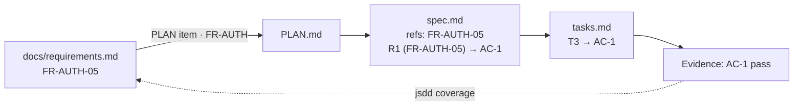
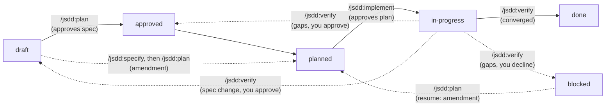
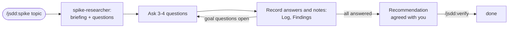

# Specs: how work gets done here

A lightweight spec-driven development (SDD) kit. Every piece of work, spike, feature, or baseline, starts as a spec in this folder, moves through a few reviewed steps, and is tracked here until it is done. The kit is a Claude Code plugin (`jsdd`): plain Markdown, one shell script, nine skills, three subagents, and six hooks. The terms used here are defined in the plugin's [glossary](https://github.com/JoDi-27/JoDi-SDD/blob/main/GLOSSARY.md).

## Where things live

| Level | File | Answers |
| --- | --- | --- |
| Product intent | `docs/intent.md` | What we are building and why, long term |
| Requirements | `docs/requirements.md` | Every functional and non-functional requirement of the product, with IDs (`FR-AUTH-05`, `NFR-SEC-03`) and priorities |
| Capabilities | `docs/capabilities/<group>.md` | How one area works now, in detail: each requirement row's current behavior, merged in from the specs that changed it |
| Decisions | `docs/decisions.md` | The register: settled choices (`DEC-nn`) and open ones (`ND-nn`), with options and reasoning |
| Roadmap | `PLAN.md`, `BACKLOG.md` | Which phase we are in, which requirements each phase delivers, which spikes are open, and a one-line item per open decision that points to its row in `docs/decisions.md` |
| Rules | `specs/constitution.md` | What every design must respect |
| Work items | `specs/NNN-slug/` | What one slice of work does, how, and how far along it is |
| Progress | `specs/STATUS.md` | Generated board of every spec |

A spec usually delivers one checklist item of `PLAN.md` (a spike, a baseline, a foundations item, a Phase 1 deliverable). If an item is too big for a few days of work, split it into several specs that depend on each other.

## Requirements and specs

`docs/requirements.md` is the product-level list of what the product must do; a spec is one slice of it made testable. They link by ID, and nothing is copied:

- Each PLAN.md item ends with the requirements it covers after a `·`: a group (`FR-SES`, every row in it) or single IDs.
- A spec's `refs` list the requirement IDs it covers, and each of its requirements is tagged with the rows it refines: `**R1** (FR-AUTH-05) When …`. Its acceptance criteria make those rows testable.
- `requirements.md` stays the source of truth. When a spec changes what a row means, or finds behavior no row has, it edits or adds the row in the same change. It never gets a status column: progress comes from the specs.
- Measurable NFRs (response times, delivery windows) become acceptance criteria in the spec that delivers them. NFRs that apply to everything are product articles in `specs/constitution.md`, checked in every plan.
- A spec's **Capability changes** table says, per row, whether it `adds`, `modifies`, or `removes` behavior. When `/jsdd:verify` closes the spec, it merges those lines into the group's capability document (`docs/capabilities/auth.md` for `FR-AUTH`): one entry per row with its current behavior in EARS form, what proves it, and the spec that last changed it. `/jsdd:specify` and `/jsdd:plan` read the entries before changing an area, and a baseline, which needs no table, writes an area's first version: every row in its `refs` is added when it closes. A removed behavior keeps its row ID, with priority `W`. `jsdd capabilities` lists the entries and the live specs about to change them, and flags a done spec whose changes were never merged.
- `jsdd coverage` joins the two: each requirement, its priority, and the specs that cover it with their status. A requirement is done once every spec that covers it is `done` (dropped specs aside). A live spec that changes a row puts it back in progress until that spec is done too.



## Lifecycle

Features, spikes, and baselines take different routes. A feature is specified, planned, and built. A spike is an interview: an agent prepares the questions, you answer and add information over as many sessions as it takes, and it ends with agreed decisions. A baseline records what existing code already does, and is closed by running its existing tests.

### Features



`/jsdd:verify` runs the project's whole test suite (`jsdd suite <ID>`, see [The test command](#the-test-command)), checks each acceptance criterion, and also reads the code against each requirement, looking for requirements that are missing or only partly built, behavior no requirement asks for, and drift from the plan. It writes what it finds to `verify-report.md` in the spec folder, with a numbered proposed action for each gap (G1, G2, …), and asks whether to fix them. Verify changes no tasks, plan, or spec. If you approve, the spec goes back to `approved` (or `draft`, for a spec change; see below), and `/jsdd:plan` plans the gaps as an **amendment**: a numbered section of the plan's Amendments (A1, A2, …) saying what each gap became, and follow-up tasks in `tasks.md` under `### A<n> · Follow-up from verify round <r>`, each naming its gap. The reviewer checks the amendment, then `/jsdd:implement` builds it and `/jsdd:verify` checks again. A gap fixed by changing the spec goes through `/jsdd:specify`, not the plan: the plan was derived from the spec, so it never edits it. If you approve a spec change, the spec goes back to `draft`; `/jsdd:specify <ID>` revises it with you, and `/jsdd:plan <ID>` then approves the revised spec and plans what it means for the build as an amendment, never a new plan. When a gap comes back after its fix was built, two rounds of fixes have not closed it, so the spec or its check is likely wrong: verify then offers only a spec change or dropping the gap. If you decline, only the report is kept and the spec is `blocked`. It stays blocked until you run `/jsdd:plan <ID>` (your approval to fix the gaps after all) or drop it.

| Status | Meaning | Set by |
| --- | --- | --- |
| `draft` | Spec written, may still have open questions. Also: a spec change you approved after verification, waiting for `/jsdd:specify` | `/jsdd:specify`; `/jsdd:verify` |
| `approved` | Spec reviewed; no open questions. Also: verification gaps you approved, waiting to be planned | `/jsdd:plan` (running it is the approval); `/jsdd:verify` |
| `planned` | Plan and tasks written, or an amendment's follow-up tasks | `/jsdd:plan` |
| `in-progress` | Tasks being done. Once every task is ticked, the board shows `ready to verify` in its Progress column and `jsdd done` names `/jsdd:verify` as the next step; this is not a status of its own, since it comes from the ticks | `/jsdd:implement` (running it is the approval of the plan) |
| `done` | Every acceptance criterion verified with evidence, and the code matches every requirement | `/jsdd:verify` |
| `blocked` | Cannot continue; the reason is in the spec's changelog. After a declined verification, `verify-report.md` holds the gaps and `/jsdd:plan` resumes it | anyone; `/jsdd:verify` when you decline its fixes |
| `dropped` | Will not be done; the reason is in the spec's changelog | anyone |

Each step stops for human review before the next one starts. The human gates are simply running the next command.

### The test command

Task checks are narrow on purpose: the tests that prove one task's acceptance criteria. So a change can pass every check and still break a test no task named, say an existing test that pins the full list of an endpoint's parameters. `/jsdd:verify` closes that gap by running the project's whole suite, the command CI runs, with `jsdd suite <ID>`, and a failing test is a gap like any other. The result is recorded in `suite-result.txt` in the spec folder, with the commit it ran on; a feature closes only on a pass for its code as it is now (`jsdd suite <ID> --check`), and changing the code afterwards makes the pass stale. The kit's own documents (`specs/`, `docs/requirements.md`, `docs/decisions.md`, `docs/capabilities/`, `PLAN.md`, `BACKLOG.md`) can change without that.

The command is the first one in backticks on the `Test command:` line of `specs/constitution.md`'s Project specifics, which `/jsdd:init` asks you for. To set it where scripts can read it, add `test_command` to `specs/jsdd.yml`, which wins over the constitution:

```yaml
version: 1
test_command: "./mvnw -B verify"   # the whole suite, as CI runs it
```

`jsdd suite --command` prints the command in use and where it came from. Both places belong to people: a run cannot change them.

### Spikes



Spikes go `draft → in-progress → done`, with no plan step.

1. `/jsdd:spike <topic>` (or a spec ID) creates the spike from its `BACKLOG.md` "Spikes" entry, with one **goal question** per question there.
2. The `spike-researcher` agent reads the repository and current docs and writes a **briefing** (what is known, what is only suggested, and what is unknown, with sources). It looks up the facts it can and drafts **questions for you**, only about what you know or decide, each with why it matters, options, and a suggested answer.
3. Claude asks the questions a few at a time. Every answer goes into the **Log** and the **Findings** of the goal questions it affects, labelled as a decision, a fact, or an assumption. Answers that raise new questions get researched or added to the queue.
4. You can add information at any time: in chat during a session, as `/jsdd:spike <ID> <notes>`, or by writing in the spike's **Inbox** section between sessions. The next session processes the Inbox and clears it.
5. When every goal question is answered, Claude drafts the recommendation and decisions for your agreement. `/jsdd:verify <ID>` then closes the spike and updates `BACKLOG.md` and `PLAN.md`.

### Baselines

A baseline is for an existing codebase. It writes down how one area works today, so its requirements count as done without being rebuilt, and the specs that change the area have rows to cite.


Baselines go `draft → in-progress → done`, with no plan or tasks.

1. `/jsdd:baseline <area>` creates the baseline spec and launches the `sdd-surveyor` agent, which reads the area's code and tests and drafts its current behavior as requirement rows, each with the code that does it and the tests that exercise it.
2. You confirm, reword, re-rank, or drop each row. Behavior you call a bug is not a row: it becomes a finding, with a BACKLOG item or a new spec.
3. The confirmed rows go into `docs/requirements.md` (source `code: <path>`), and the spec gets one acceptance criterion per behavior, each checked by an existing test or a recorded manual check. Nothing is built and no test is written. Once nothing is left to clarify, the status is `in-progress`.
4. `/jsdd:verify <ID>` ticks each acceptance criterion with `jsdd done <ID> AC-n`, which runs its check. When a check fails, the description is fixed to match the code, never the other way round. When all pass, the baseline is `done` and its rows count as done.

Baselines are written one area at a time, just before work first changes that area: `/jsdd:specify` suggests one when a feature touches existing code with no rows. Areas no work touches stay unrecorded. When a feature later changes a baselined row, its spec cites the row and rewords it, and coverage shows the row in progress until that feature is done.

## Existing codebases

`/jsdd:init` works on a project that already has code. `jsdd init` never overwrites a file: a project file at a kit path that is not in the kit's format (its own `PLAN.md`, say) is reported as `keep`, and `/jsdd:init` offers to move it to `docs/legacy/` and fold its content into the kit's version. `jsdd init` also lists, as `source`, documents under other names that may hold a starter's content (`PRODUCT_INTENT.md`, `docs/PRD.md`, `docs/adr/`); `/jsdd:init` reads them and proposes what each one feeds, for you to confirm. It also reports the existing code and the test commands it finds. It lists, as `stale`, Markdown files such as `CLAUDE.md` that still name the install.sh kit (`/sdd-*` commands, `specs/_kit/sdd`), which `/jsdd:init` offers to point at `/jsdd:*` and `jsdd`.

On an existing product the interview surveys the code (with the `sdd-surveyor` agent) for its areas, test command, conventions, and choices already made. It records rows only for the new behavior the next milestone brings, and plans one baseline per area the milestone touches, in Phase 0. Phase 1 is the next milestone rather than an MVP.

## Working in parallel

Several Claude Code sessions can work at once, in one checkout or in separate worktrees. Each session claims its work before starting it, so two sessions never pick the same thing:

- `/jsdd:implement` claims one task at a time with `jsdd claim <ID> next`. That hands out the first task that is not ticked, not claimed, and whose earlier tasks are finished. Consecutive `[P]` tasks can be handed out together, so they are where parallel work within one spec comes from. An explicit `jsdd claim <ID> <Tn>` follows the same order and is refused while earlier tasks are unfinished.
- `/jsdd:specify`, `/jsdd:plan`, `/jsdd:spike`, `/jsdd:baseline`, and `/jsdd:verify` claim the whole spec. A spike stays claimed while its interview runs; a second session only adds notes to its Inbox.
- `jsdd next` skips work other sessions hold and shows which tasks are free. `jsdd status` lists the claims.

A claim is a directory created with `mkdir`, which is atomic, under `.git/sdd-claims/`. Every worktree on this machine shares it, and git does not track it. The owner is the Claude Code session ID. `jsdd done` marks a finished task done, and it stays marked until `jsdd claims --prune` sees its tick, because other worktrees do not see the tick until it is merged. `jsdd new` also reserves the spec ID there, so two worktrees never create the same number; prune drops the reservation only once the spec is on `main`. Prune never drops a claim whose spec folder is missing in this worktree, because that spec may live on another worktree's branch.

A session that ends without releasing leaves its claim behind. Claims older than 8 hours (`SDD_STALE_HOURS`) are shown as stale; free one with `jsdd release <ID> [Tn] --force` once you know that session is gone. When a task is marked done, its claim records the branch it was done on. A later claim on the same spec, from a checkout that does not have the tick yet, says which branch to merge or rebase onto first.

### Several people: claims through the git remote

By default, claims only coordinate sessions on one machine. When several people work on their own clones, each of them turns on remote claims once:

```sh
git config jsdd.claims remote
git config jsdd.claimsRemote origin   # optional; origin is the default
```

Each claim then becomes a ref on the remote, `refs/sdd-claims/003-T4` for example. The ref points at an empty commit whose message records who holds the claim. Taking a claim is a push that the remote accepts only if the ref does not exist yet, so when two people claim the same task at once, exactly one wins. Releasing and marking done are pushes leased on the ref this session last saw. The commands, and the skills that call them, stay the same.

- **Reads** (`jsdd status`, `next`, `claims`, the session-start board) fetch the claims, and reuse a fetch made in the last 30 seconds (`SDD_CLAIMS_REUSE`). They show `(remote origin, as of 14:02)`. If the remote is unreachable, they show the last fetch and say so.
- **Writes** (`claim`, `release`, `done`, `new`, `claims --prune`) always fetch first, and fail when the remote is unreachable, so nothing is claimed that others cannot see. To work offline, `SDD_CLAIMS=local jsdd claim ...` takes a claim on this machine only. Release it the same way once you are back. Until then, `jsdd claims` warns that it is not shared. A remote that stops answering is given up after 15 seconds (`SDD_CLAIMS_TIMEOUT`).
- **`jsdd new`** also counts the IDs other clones reserved, and the specs on the remote's `main`.
- **`jsdd claims --prune`** reads the specs on the remote's `main` branch, not your checkout. A task done on your branch keeps its claim until its tick is merged, so nobody else picks it up in the meantime.
- A plain `git clone` fetches none of these refs, and they are not branches. GitHub accepts them. Other hosts, Gerrit in particular, may refuse custom ref namespaces.
- The refs coordinate people who cooperate. They enforce nothing: anyone with push access can delete them.

## Runtime modes

Every point where a skill waits for a person is a named **gate**: approving a spec (`spec.approve`), answering a clarifying question (`spec.clarify`), approving the fixes a verification proposes (`verify.gaps`), and so on. The skills mark each one, like (gate `plan.approve`). A **runtime mode** says what happens at every gate: `ask` (a person decides), `auto` (a check, a reviewer, or a rule passes it), or `park` (the work waits on the board, and nothing is guessed). `jsdd mode --explain` lists every gate and its policy.

The kit runs in `manual` mode, where every gate asks, exactly as described in this file. The other modes:

- **`autopilot`**: you write and approve the spec; `/jsdd:auto <ID>` does the rest, up to a pull request, without asking you anything. See [Autopilot](#autopilot) below.
- **`autonomous`**: the team commits a charter that says what runs may do on their own; `/jsdd:auto` then works through the queue, spec after spec, each to a pull request, and has the `sdd-product` agent decide product questions, and merge converged work, as far as the charter allows. See [Autonomous](#autonomous) below.

Two settings choose the mode:

- `specs/jsdd.yml`, committed, says which modes this project allows and can tune their gates. With no file, only `manual` is allowed.
- `SDD_MODE`, set by each person (in the shell, or under `env` in `.claude/settings.local.json`), picks the mode for their sessions. A mode that needs consent, `autopilot` or `autonomous`, can only be picked this way, never as the file's `default`.

```yaml
version: 1
modes: [manual, autopilot]    # manual is always allowed
default: manual
autopilot:                    # gates and budgets to change from the mode's own
  verify.gap_option: park     # never pick an option without a person
  attempts_per_task: 5        # tries at one task before it parks (default 3)
  wall_time_hours: 6          # hours a run may take (default 4)
```

It fails closed. `jsdd mode --check` lists every unknown key, gate, or value, and exits 1. While the file is invalid, or `SDD_MODE` names a mode that is unknown, not allowed, or not available, every gate asks, and the board starts with a `Mode warning:` line. Any mode other than `manual` is printed at the top of the board, so a session never runs in one without saying so. The mode is never written to `specs/STATUS.md`, because it belongs to the person, not the project.

### Autopilot

Two approvals, nothing in between: you approve the spec by starting the run, and the result by merging the pull request.

1. Write the spec with `/jsdd:specify` and answer its questions, until it has no `[NEEDS CLARIFICATION]` markers.
2. With `SDD_MODE=autopilot`, run `/jsdd:auto <ID>`. It commits the spec, moves to a branch (`autopilot/<ID>-<slug>`) if you are on the main branch, and starts.
3. It plans the spec, and the `sdd-reviewer` approves the plan: an autopilot plan has a command check for every task and AC, and none that passes before the work is done. The checks are then frozen (`checks.lock`).
4. It implements every task, ticking each only when its check passes, one commit per task. A check that keeps failing gets `attempts_per_task` tries.
5. It verifies, running the project's whole test suite as well as each AC's check. Gaps whose fix is code with a check (a test the suite broke, say), or a harmless Deviation the reviewer recommends, are approved and built, then verified again. Converged closes the spec.
6. It writes `run-report.md` in the spec folder, pushes the branch, and opens a pull request whose body `jsdd pr <ID>` writes: the requirements, the evidence, the full suite's result, the deviations, and every decision made without you. The pull request is a draft unless `jsdd pr <ID> --ready` passes: the spec is done, not parked, and the full suite passed on its code. A run whose spec is done without that pass ends `failed`, and `jsdd auto run` turns a ready pull request back into a draft.

What a machine cannot settle **parks** the spec instead of being guessed: a spec change, a manual check, a product choice between options, a gap that survives two rounds, a check that still fails, something only a person can do. A parked spec keeps its status, says why in its frontmatter (`parked:`) and changelog, shows under "Waiting for you" on the board, and `jsdd next` skips it. The run still ends with a **draft** pull request saying what waits for you. Settle it, run `jsdd unpark <ID>`, and `/jsdd:auto <ID>` again continues on the same branch.

Guardrails: every decision the run makes is written as `auto: <gate>` with what passed it, never as yours; `jsdd done` refuses a task whose check changed since the plan was approved, unless a Deviation names it and `jsdd freeze <ID> --accept <Tn>` records it; a hook blocks edits to `specs/constitution.md`, `docs/intent.md`, `specs/jsdd.yml`, `checks.lock`, and `suite-result.txt` during a run; the run never force-pushes, and autopilot never merges. A Stop hook keeps the session going while the run has work left and is making progress, and lets it stop when it is parked, out of time, or stuck.

The run cannot answer permission prompts. Give the session a permission mode that does not prompt for file edits, your build and test commands, `git`, and `gh`; otherwise the run stalls at the first prompt. `jsdd auto doctor` checks it and prints the fix, and checks that a test command is set.

The full suite runs at least once per verification round, and its time counts against `wall_time_hours`. For a suite that takes most of an hour, raise the budget to match; `jsdd suite` prints how long each run took, and the run report's Timeline records it.

### Autonomous

The team approves once, up front, by committing a **charter**, and once at the end, by reading the run reports and pull requests. Every gate in between is passed by a check, the fresh-context reviewer, or a rule in the charter; what none of those can pass parks, as in autopilot. Two sides must agree: the project, by committing the charter, and the person, by setting `SDD_MODE=autonomous` and typing `/jsdd:auto`. Someone who clones a repository with a charter never starts a run without doing both.

The charter is the `autonomous:` section of `specs/jsdd.yml`. `/jsdd:auto setup` asks a few questions and writes it:

```yaml
version: 1
modes: [manual, autonomous]
autonomous:
  preset: cautious            # cautious | standard | hands-off
  product: cited              # optional, overrides the preset: park | cited | inferred | uncited | all
  types: [feature]            # what a loop takes: feature, baseline, spike
  phases: [1]                 # PLAN.md phases; leave out for every phase
  exclude_groups: [FR-BILLING]  # requirement groups a run never touches
  specs_per_run: 3            # specs a loop takes before it stops (default 3)
  wall_time_hours: 4          # for the whole loop (default 4)
  verify.gap_option: park     # any gate can still be set, and wins over the preset
```

Product questions (an open marker, gap options that differ in what a user would notice, a spec change from verification, which part of a split comes first) go to the **`sdd-product`** agent. It reads only the product documents and the code, never the session that asked, answers each one, and classifies the answer by what supports it:

| Class | The answer |
| --- | --- |
| `cited` | is already in the docs: a DEC row, a requirement, a suggested default in `BACKLOG.md`, the intent |
| `inferred` | follows from the stated principles, and the agent shows the step |
| `uncited` | has nothing in the docs to go on, so the agent picks the most reversible, smallest, closest, or most consistent option, and names the rule |
| `conflict` | is one where the docs contradict each other, so it picks the newer or more specific source and flags the conflict |

The charter's `product` setting caps how far a run may act: `park`, `cited`, `inferred`, `uncited`, or `all`. An answer beyond it parks, with the agent's answer in the reason. An answer that would change the constitution, the intent, or a Must row's priority parks under every preset. Each decision acted on is written as `(assumed, auto: product, sdd-product, <class> (<basis>))`, gets an `AS-nn` row in the Assumed section of `docs/decisions.md`, and is listed in the run report weakest basis first, with what it would cost to undo. Confirm a row and it becomes a DEC row; later runs then cite it. Reject it and it is removed, with a BACKLOG item or a spec to undo it.

| Preset | `product` | Spec changes from verify (`spec.change`) | Merge (`merge`) |
| --- | --- | --- | --- |
| `cautious` (also when none is set) | `cited` | park | a pull request for you to merge |
| `standard` | `inferred` | park | a pull request for you to merge |
| `hands-off` | `all` | `sdd-product` decides | merged once the spec converged and every CI check passed |

In every preset, manual checks, owner questions in spikes, a dependency that is not done, and a gap that survives two rounds park. `jsdd charter` prints the effective values.

The three steps:

1. **`/jsdd:auto setup`** writes the charter, and `jsdd mode --check` validates it. Each person who runs it sets `SDD_MODE=autonomous`.
2. **`/jsdd:auto --dry-run`** (`jsdd auto dry-run`) shows what a loop would take, in order, where each spec would park ("would park at spec.clarify: 2 open questions"), and why each other spec is left out. `/jsdd:auto doctor` (`jsdd auto doctor`) checks the charter, the mode, a clean work tree, `gh`, and the permission mode, with the exact fix for each.
3. **`/jsdd:auto <ID>`** runs one spec, as autopilot does but with nobody's approval: the `sdd-reviewer` approves the spec in its spec mode (testable requirements, an AC for each, the error, empty, and permission cases, size) before planning. **`/jsdd:auto`** with no ID runs the loop: `jsdd run start --loop`, then `jsdd run next` for each spec (each on its own branch `autonomous/<ID>-<slug>`, each with its run report and pull request), until the queue is empty, `specs_per_run` is reached, or the time is spent. The loop writes `specs/runs/<date>-<n>.md`: each spec's outcome, what waits for you, every product decision, and a short digest to read in the morning.

The queue (`jsdd auto queue`) is what `jsdd next` offers, narrowed to the charter's scope, minus blocked and parked specs, a spec change waiting from verify, and specs another session holds. Spikes run only on what the researcher can answer from the docs and code; a question for the owner parks them. Baselines run only once a person created them for an area: the reviewer confirms each row, a Must row goes in as Should for the owner to confirm, and a bug goes to Findings and `BACKLOG.md`, never into a row.

`/jsdd:init` stays a person's job: a project needs its intent and constitution before any run.

## Automation

Claude Code hooks keep the kit honest: they print the board and the claims at session start, regenerate `specs/STATUS.md` when a spec, task list, `PLAN.md`, or `docs/requirements.md` changes, block commit messages without a spec ID or `[meta]`, and warn at the end of a session that still holds claims. During an autopilot or autonomous run, they also block edits to the files a run must not change, and keep the session going until the run is done or parked. The hooks, skills, agents, and the `jsdd` script live in the plugin, not in this repository; the hooks do nothing in a project without `specs/constitution.md`.

## Artifacts

| File | Feature | Spike | Baseline | Content |
| --- | --- | --- | --- | --- |
| `spec.md` | yes | yes (spike template) | yes (baseline template) | What and why: scenarios, EARS requirements, acceptance criteria. For a spike: inbox, goal questions, briefing, questions for you, log, findings, decisions. For a baseline: area, current behavior, acceptance criteria with their checks, findings, evidence |
| `plan.md` | yes | no | no | How: design, decisions, constitution check, test strategy, deviations |
| `tasks.md` | yes | no | no | Ordered, small, checkable tasks, plus verification evidence |
| `prototype/` | no | yes | no | Throwaway code for a spike, never shipped |
| `checks.lock` | autopilot, autonomous | no | no | Each task's check, frozen when the plan was approved (`jsdd freeze`) |
| `run-report.md` | autopilot, autonomous | autonomous | autonomous | What a run did, every decision and product decision it made without a person, and what parked |

Templates are in the plugin's `templates/` folder. Frontmatter in `spec.md` is what the tooling reads:

```yaml
id: 003                # matches the folder number
type: feature          # feature | spike | baseline
status: draft          # see Lifecycle
phase: 1               # PLAN.md phase
depends_on: [001, 002] # specs that must be done first
refs: ["PLAN Phase 1 / Core", "FR-AUTH-05", "FR-AUTH-09"]  # PLAN and BACKLOG items, and requirement IDs
updated: 2026-10-07
```

## Commands

In Claude Code:

| Command | Does |
| --- | --- |
| `/jsdd:spike <ID, PLAN spike number, or topic> [notes]` | Runs a spike as an interview; with notes, records them first |
| `/jsdd:specify <idea, PLAN item, or spec ID>` | Creates a feature spec (or refines an existing one) and asks the questions that block it |
| `/jsdd:plan <ID>` | Approves the spec, then writes `plan.md` and `tasks.md` |
| `/jsdd:implement <ID> [task]` | Works through the tasks in order, ticking each when its check passes |
| `/jsdd:baseline <area or ID> [what is about to change]` | Records how an area of existing code works today: rows in `docs/requirements.md` and a baseline spec checked by the existing tests |
| `/jsdd:verify <ID>` | Checks every acceptance criterion (or a spike's answers), records evidence, closes the spec, updates PLAN and BACKLOG |
| `/jsdd:auto <ID>` | In autopilot or autonomous mode: plans, implements, and verifies a spec, then opens a pull request, without asking anything; parks what only a person can decide |
| `/jsdd:auto` | In autonomous mode: works through the queue within the charter, spec after spec, and writes a loop report |
| `/jsdd:auto setup \| --dry-run \| doctor` | Writes the charter; shows what a loop would take and where it would park; checks what an unattended run needs |
| `/jsdd:status [ID]` | Shows the board and what to do next |
| `/jsdd:init [--migrate] [notes]` | Sets up a project (starters, settings, `.gitignore`), then interviews you to fill the starters, surveying the code on an existing product; or moves it off the old install.sh copy |

From a shell. In Claude Code the plugin puts `jsdd` on the Bash tool's PATH; in your own terminal, use its path in the plugin's `bin/` folder:

```sh
jsdd new feature "User invites"      # or: new spike "...", new baseline "..."
jsdd status                          # board + next up
jsdd status --write                  # also regenerates specs/STATUS.md
jsdd next                            # only what can be worked on now
jsdd claim 003 next                  # claim the next free task of 003; prints its ID
jsdd done 003 T4                     # run T4's check; only if it passes, tick T4 and mark it done
jsdd done 004 AC-2                   # the same for a baseline's acceptance criterion
jsdd claims --prune                  # list claims, dropping the ones no longer needed
git config jsdd.claims remote        # share claims with other people's clones through origin
jsdd coverage FR-AUTH                # requirements in a group, with the specs covering each
jsdd coverage --phase 1 --priority M --missing   # Phase 1 Musts with no spec yet
jsdd capabilities FR-AUTH            # rows with a capability entry, and live specs about to change them
jsdd mode --explain                  # the runtime mode, and what happens at each gate
jsdd gate plan.approve               # one gate's policy in the current mode: ask, auto, or park
jsdd park 003 spec.change "R2 contradicts FR-AUTH-05"   # park a spec at a gate; jsdd unpark 003 puts it back
jsdd freeze 003                      # record each task's check in checks.lock; done refuses a changed one
jsdd suite 003                       # run the project's whole test suite on 003's code and record the result
jsdd suite 003 --check               # whether a pass is recorded for the code as it is now
jsdd pr 003                          # a pull request body from the spec, evidence, deviations, and run report
jsdd auto dry-run                    # what an autonomous loop would take, and where each spec would park
jsdd auto doctor                     # what an unattended run still needs, with the fix for each
jsdd charter                         # the charter's effective values: preset, product class, scope, budgets
```

Progress is computed from the files: checkboxes in `tasks.md` (for a spike, the goal questions, questions for you, and deliverables in `spec.md`; for a baseline, its acceptance criteria), and the open questions count from the `[NEEDS CLARIFICATION: …]` markers in `spec.md` and `plan.md`. HTML comments are ignored, so template guidance never counts.

## Good practices this kit enforces

- **What before how.** `spec.md` has no technology in it; `plan.md` has no new requirements in it.
- **No guessing.** Unknowns are written as `[NEEDS CLARIFICATION: …]` and must be resolved before planning.
- **Testable requirements.** Requirements use EARS ("When …, the system shall …"). Every requirement is covered by an acceptance criterion, and every acceptance criterion by a test or a recorded manual check.
- **Traceability.** IDs link everything: FR-AUTH-05 → R1 → AC-1 → T3 → commit `[003] T3 …` → evidence row.
- **Small tasks.** Half a day at most, each leaving the build green, test first where it fits.
- **Checks that run.** Each task's check is a command in backticks, and `jsdd done` ticks the task only when that command exits 0. A check no command can prove is written `check: manual: …`, and `jsdd done --manual "<who checked what>"` records the note on the task. A check that needs more than one short command goes in a script the check runs.
- **Tasks as blocks.** A task is a head line (`- [ ] **T3** <title> → AC-1`) with indented sub-bullets for its files, its one check, and notes. A short task can still be one line. Blocks keep long tasks readable, and ticks on neighboring tasks in two worktrees merge without a conflict.
- **Fresh-eyes review.** `/jsdd:plan` and `/jsdd:verify` ask the `sdd-reviewer` agent, which never saw the session that wrote the work, for a second opinion on the plan and on each acceptance criterion.
- **Living documents.** When reality disagrees with the spec or plan, the document changes first and the change is logged (spec changelog, plan Deviations).
- **Decisions on record.** Every real choice gets a row with alternatives and rationale. A choice that settles an open decision moves its row in `docs/decisions.md` from Still open to Decided, and ticks the BACKLOG item.
- **Constitution check.** Every plan states how it respects the articles it touches.
