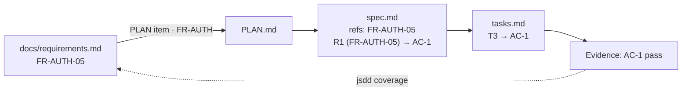
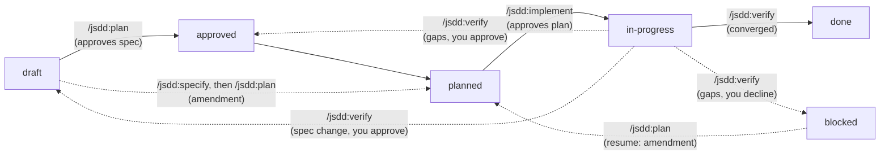
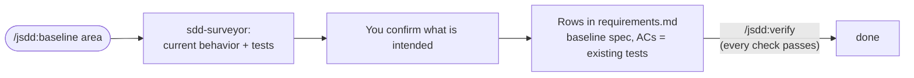

# Specs: how work gets done here

A lightweight spec-driven development (SDD) kit. Every piece of work, spike, feature, or baseline, starts as a spec in this folder, moves through a few reviewed steps, and is tracked here until it is done. The kit is a Claude Code plugin (`jsdd`): plain Markdown, one shell script, eight skills, three subagents, and four hooks. The terms used here are defined in the plugin's [glossary](https://github.com/JoDi-27/JoDi-SDD/blob/main/GLOSSARY.md).

## Where things live

| Level | File | Answers |
| --- | --- | --- |
| Product intent | `docs/intent.md` | What we are building and why, long term |
| Requirements | `docs/requirements.md` | Every functional and non-functional requirement of the product, with IDs (`FR-AUTH-05`, `NFR-SEC-03`) and priorities |
| Capabilities | `docs/capabilities/<group>.md` | How one area works now, in detail: each requirement row's current behavior, merged in from the specs that changed it |
| Decisions | `docs/decisions.md` | The register: settled choices (`DEC-nn`) and open ones (`ND-nn`), with options and reasoning |
| Roadmap | `PLAN.md`, `BACKLOG.md` | Which phase we are in, which requirements each phase delivers, which spikes are open, and a one-line item per open decision that points to its row in `docs/decisions.md` |
| Rules | `specs/constitution.md` | What every design must respect |
| Work items | `specs/NNN-slug/` | What one slice of work does, how, and how far along it is |
| Progress | `specs/STATUS.md` | Generated board of every spec |

A spec usually delivers one checklist item of `PLAN.md` (a spike, a baseline, a foundations item, a Phase 1 deliverable). If an item is too big for a few days of work, split it into several specs that depend on each other.

## Requirements and specs

`docs/requirements.md` is the product-level list of what the product must do; a spec is one slice of it made testable. They link by ID, and nothing is copied:

- Each PLAN.md item ends with the requirements it covers after a `·`: a group (`FR-SES`, every row in it) or single IDs.
- A spec's `refs` list the requirement IDs it covers, and each of its requirements is tagged with the rows it refines: `**R1** (FR-AUTH-05) When …`. Its acceptance criteria make those rows testable.
- `requirements.md` stays the source of truth. When a spec changes what a row means, or finds behavior no row has, it edits or adds the row in the same change. It never gets a status column: progress comes from the specs.
- Measurable NFRs (response times, delivery windows) become acceptance criteria in the spec that delivers them. NFRs that apply to everything are product articles in `specs/constitution.md`, checked in every plan.
- A spec's **Capability changes** table says, per row, whether it `adds`, `modifies`, or `removes` behavior. When `/jsdd:verify` closes the spec, it merges those lines into the group's capability document (`docs/capabilities/auth.md` for `FR-AUTH`): one entry per row with its current behavior in EARS form, what proves it, and the spec that last changed it. `/jsdd:specify` and `/jsdd:plan` read the entries before changing an area, and a baseline, which needs no table, writes an area's first version: every row in its `refs` is added when it closes. A removed behavior keeps its row ID, with priority `W`. `jsdd capabilities` lists the entries and the live specs about to change them, and flags a done spec whose changes were never merged.
- `jsdd coverage` joins the two: each requirement, its priority, and the specs that cover it with their status. A requirement is done once every spec that covers it is `done` (dropped specs aside). A live spec that changes a row puts it back in progress until that spec is done too.



## Lifecycle

Features, spikes, and baselines take different routes. A feature is specified, planned, and built. A spike is an interview: an agent prepares the questions, you answer and add information over as many sessions as it takes, and it ends with agreed decisions. A baseline records what existing code already does, and is closed by running its existing tests.

### Features



`/jsdd:verify` checks each acceptance criterion and also reads the code against each requirement, looking for requirements that are missing or only partly built, behavior no requirement asks for, and drift from the plan. It writes what it finds to `verify-report.md` in the spec folder, with a numbered proposed action for each gap (G1, G2, …), and asks whether to fix them. Verify changes no tasks, plan, or spec. If you approve, the spec goes back to `approved` (or `draft`, for a spec change; see below), and `/jsdd:plan` plans the gaps as an **amendment**: a numbered section of the plan's Amendments (A1, A2, …) saying what each gap became, and follow-up tasks in `tasks.md` under `### A<n> · Follow-up from verify round <r>`, each naming its gap. The reviewer checks the amendment, then `/jsdd:implement` builds it and `/jsdd:verify` checks again. A gap fixed by changing the spec goes through `/jsdd:specify`, not the plan: the plan was derived from the spec, so it never edits it. If you approve a spec change, the spec goes back to `draft`; `/jsdd:specify <ID>` revises it with you, and `/jsdd:plan <ID>` then approves the revised spec and plans what it means for the build as an amendment, never a new plan. When a gap comes back after its fix was built, two rounds of fixes have not closed it, so the spec or its check is likely wrong: verify then offers only a spec change or dropping the gap. If you decline, only the report is kept and the spec is `blocked`. It stays blocked until you run `/jsdd:plan <ID>` (your approval to fix the gaps after all) or drop it.

| Status | Meaning | Set by |
| --- | --- | --- |
| `draft` | Spec written, may still have open questions. Also: a spec change you approved after verification, waiting for `/jsdd:specify` | `/jsdd:specify`; `/jsdd:verify` |
| `approved` | Spec reviewed; no open questions. Also: verification gaps you approved, waiting to be planned | `/jsdd:plan` (running it is the approval); `/jsdd:verify` |
| `planned` | Plan and tasks written, or an amendment's follow-up tasks | `/jsdd:plan` |
| `in-progress` | Tasks being done. Once every task is ticked, the board shows `ready to verify` in its Progress column and `jsdd done` names `/jsdd:verify` as the next step; this is not a status of its own, since it comes from the ticks | `/jsdd:implement` (running it is the approval of the plan) |
| `done` | Every acceptance criterion verified with evidence, and the code matches every requirement | `/jsdd:verify` |
| `blocked` | Cannot continue; the reason is in the spec's changelog. After a declined verification, `verify-report.md` holds the gaps and `/jsdd:plan` resumes it | anyone; `/jsdd:verify` when you decline its fixes |
| `dropped` | Will not be done; the reason is in the spec's changelog | anyone |

Each step stops for human review before the next one starts. The human gates are simply running the next command.

### Spikes


Spikes go `draft → in-progress → done`, with no plan step.

1. `/jsdd:spike <topic>` (or a spec ID) creates the spike from its `BACKLOG.md` "Spikes" entry, with one **goal question** per question there.
2. The `spike-researcher` agent reads the repository and current docs and writes a **briefing** (what is known, what is only suggested, and what is unknown, with sources). It looks up the facts it can and drafts **questions for you**, only about what you know or decide, each with why it matters, options, and a suggested answer.
3. Claude asks the questions a few at a time. Every answer goes into the **Log** and the **Findings** of the goal questions it affects, labelled as a decision, a fact, or an assumption. Answers that raise new questions get researched or added to the queue.
4. You can add information at any time: in chat during a session, as `/jsdd:spike <ID> <notes>`, or by writing in the spike's **Inbox** section between sessions. The next session processes the Inbox and clears it.
5. When every goal question is answered, Claude drafts the recommendation and decisions for your agreement. `/jsdd:verify <ID>` then closes the spike and updates `BACKLOG.md` and `PLAN.md`.

### Baselines

A baseline is for an existing codebase. It writes down how one area works today, so its requirements count as done without being rebuilt, and the specs that change the area have rows to cite.



Baselines go `draft → in-progress → done`, with no plan or tasks.

1. `/jsdd:baseline <area>` creates the baseline spec and launches the `sdd-surveyor` agent, which reads the area's code and tests and drafts its current behavior as requirement rows, each with the code that does it and the tests that exercise it.
2. You confirm, reword, re-rank, or drop each row. Behavior you call a bug is not a row: it becomes a finding, with a BACKLOG item or a new spec.
3. The confirmed rows go into `docs/requirements.md` (source `code: <path>`), and the spec gets one acceptance criterion per behavior, each checked by an existing test or a recorded manual check. Nothing is built and no test is written. Once nothing is left to clarify, the status is `in-progress`.
4. `/jsdd:verify <ID>` ticks each acceptance criterion with `jsdd done <ID> AC-n`, which runs its check. When a check fails, the description is fixed to match the code, never the other way round. When all pass, the baseline is `done` and its rows count as done.

Baselines are written one area at a time, just before work first changes that area: `/jsdd:specify` suggests one when a feature touches existing code with no rows. Areas no work touches stay unrecorded. When a feature later changes a baselined row, its spec cites the row and rewords it, and coverage shows the row in progress until that feature is done.

## Existing codebases

`/jsdd:init` works on a project that already has code. `jsdd init` never overwrites a file: a project file at a kit path that is not in the kit's format (its own `PLAN.md`, say) is reported as `keep`, and `/jsdd:init` offers to move it to `docs/legacy/` and fold its content into the kit's version. `jsdd init` also lists, as `source`, documents under other names that may hold a starter's content (`PRODUCT_INTENT.md`, `docs/PRD.md`, `docs/adr/`); `/jsdd:init` reads them and proposes what each one feeds, for you to confirm. It also reports the existing code and the test commands it finds. It lists, as `stale`, Markdown files such as `CLAUDE.md` that still name the install.sh kit (`/sdd-*` commands, `specs/_kit/sdd`), which `/jsdd:init` offers to point at `/jsdd:*` and `jsdd`.

On an existing product the interview surveys the code (with the `sdd-surveyor` agent) for its areas, test command, conventions, and choices already made. It records rows only for the new behavior the next milestone brings, and plans one baseline per area the milestone touches, in Phase 0. Phase 1 is the next milestone rather than an MVP.

## Working in parallel

Several Claude Code sessions can work at once, in one checkout or in separate worktrees. Each session claims its work before starting it, so two sessions never pick the same thing:

- `/jsdd:implement` claims one task at a time with `jsdd claim <ID> next`. That hands out the first task that is not ticked, not claimed, and whose earlier tasks are finished. Consecutive `[P]` tasks can be handed out together, so they are where parallel work within one spec comes from. An explicit `jsdd claim <ID> <Tn>` follows the same order and is refused while earlier tasks are unfinished.
- `/jsdd:specify`, `/jsdd:plan`, `/jsdd:spike`, `/jsdd:baseline`, and `/jsdd:verify` claim the whole spec. A spike stays claimed while its interview runs; a second session only adds notes to its Inbox.
- `jsdd next` skips work other sessions hold and shows which tasks are free. `jsdd status` lists the claims.

A claim is a directory created with `mkdir`, which is atomic, under `.git/sdd-claims/`. Every worktree on this machine shares it, and git does not track it. The owner is the Claude Code session ID. `jsdd done` marks a finished task done, and it stays marked until `jsdd claims --prune` sees its tick, because other worktrees do not see the tick until it is merged. `jsdd new` also reserves the spec ID there, so two worktrees never create the same number; prune drops the reservation only once the spec is on `main`. Prune never drops a claim whose spec folder is missing in this worktree, because that spec may live on another worktree's branch.

A session that ends without releasing leaves its claim behind. Claims older than 8 hours (`SDD_STALE_HOURS`) are shown as stale; free one with `jsdd release <ID> [Tn] --force` once you know that session is gone. Claims only coordinate sessions on one machine.

## Automation

Claude Code hooks keep the kit honest: they print the board and the claims at session start, regenerate `specs/STATUS.md` when a spec, task list, `PLAN.md`, or `docs/requirements.md` changes, block commit messages without a spec ID or `[meta]`, and warn at the end of a session that still holds claims. The hooks, skills, agents, and the `jsdd` script live in the plugin, not in this repository; the hooks do nothing in a project without `specs/constitution.md`.

## Artifacts

| File | Feature | Spike | Baseline | Content |
| --- | --- | --- | --- | --- |
| `spec.md` | yes | yes (spike template) | yes (baseline template) | What and why: scenarios, EARS requirements, acceptance criteria. For a spike: inbox, goal questions, briefing, questions for you, log, findings, decisions. For a baseline: area, current behavior, acceptance criteria with their checks, findings, evidence |
| `plan.md` | yes | no | no | How: design, decisions, constitution check, test strategy, deviations |
| `tasks.md` | yes | no | no | Ordered, small, checkable tasks, plus verification evidence |
| `prototype/` | no | yes | no | Throwaway code for a spike, never shipped |

Templates are in the plugin's `templates/` folder. Frontmatter in `spec.md` is what the tooling reads:

```yaml
id: 003                # matches the folder number
type: feature          # feature | spike | baseline
status: draft          # see Lifecycle
phase: 1               # PLAN.md phase
depends_on: [001, 002] # specs that must be done first
refs: ["PLAN Phase 1 / Core", "FR-AUTH-05", "FR-AUTH-09"]  # PLAN and BACKLOG items, and requirement IDs
updated: 2026-10-07
```

## Commands

In Claude Code:

| Command | Does |
| --- | --- |
| `/jsdd:spike <ID, PLAN spike number, or topic> [notes]` | Runs a spike as an interview; with notes, records them first |
| `/jsdd:specify <idea, PLAN item, or spec ID>` | Creates a feature spec (or refines an existing one) and asks the questions that block it |
| `/jsdd:plan <ID>` | Approves the spec, then writes `plan.md` and `tasks.md` |
| `/jsdd:implement <ID> [task]` | Works through the tasks in order, ticking each when its check passes |
| `/jsdd:baseline <area or ID> [what is about to change]` | Records how an area of existing code works today: rows in `docs/requirements.md` and a baseline spec checked by the existing tests |
| `/jsdd:verify <ID>` | Checks every acceptance criterion (or a spike's answers), records evidence, closes the spec, updates PLAN and BACKLOG |
| `/jsdd:status [ID]` | Shows the board and what to do next |
| `/jsdd:init [--migrate] [notes]` | Sets up a project (starters, settings, `.gitignore`), then interviews you to fill the starters, surveying the code on an existing product; or moves it off the old install.sh copy |

From a shell. In Claude Code the plugin puts `jsdd` on the Bash tool's PATH; in your own terminal, use its path in the plugin's `bin/` folder:

```sh
jsdd new feature "User invites"      # or: new spike "...", new baseline "..."
jsdd status                          # board + next up
jsdd status --write                  # also regenerates specs/STATUS.md
jsdd next                            # only what can be worked on now
jsdd claim 003 next                  # claim the next free task of 003; prints its ID
jsdd done 003 T4                     # run T4's check; only if it passes, tick T4 and mark it done
jsdd done 004 AC-2                   # the same for a baseline's acceptance criterion
jsdd claims --prune                  # list claims, dropping the ones no longer needed
jsdd coverage FR-AUTH                # requirements in a group, with the specs covering each
jsdd coverage --phase 1 --priority M --missing   # Phase 1 Musts with no spec yet
jsdd capabilities FR-AUTH            # rows with a capability entry, and live specs about to change them
```

Progress is computed from the files: checkboxes in `tasks.md` (for a spike, the goal questions, questions for you, and deliverables in `spec.md`; for a baseline, its acceptance criteria), and the open questions count from the `[NEEDS CLARIFICATION: …]` markers in `spec.md` and `plan.md`. HTML comments are ignored, so template guidance never counts.

## Good practices this kit enforces

- **What before how.** `spec.md` has no technology in it; `plan.md` has no new requirements in it.
- **No guessing.** Unknowns are written as `[NEEDS CLARIFICATION: …]` and must be resolved before planning.
- **Testable requirements.** Requirements use EARS ("When …, the system shall …"). Every requirement is covered by an acceptance criterion, and every acceptance criterion by a test or a recorded manual check.
- **Traceability.** IDs link everything: FR-AUTH-05 → R1 → AC-1 → T3 → commit `[003] T3 …` → evidence row.
- **Small tasks.** Half a day at most, each leaving the build green, test first where it fits.
- **Checks that run.** Each task's check is a command in backticks, and `jsdd done` ticks the task only when that command exits 0. A check no command can prove is written `check: manual: …`, and `jsdd done --manual "<who checked what>"` records the note on the task.
- **Fresh-eyes review.** `/jsdd:plan` and `/jsdd:verify` ask the `sdd-reviewer` agent, which never saw the session that wrote the work, for a second opinion on the plan and on each acceptance criterion.
- **Living documents.** When reality disagrees with the spec or plan, the document changes first and the change is logged (spec changelog, plan Deviations).
- **Decisions on record.** Every real choice gets a row with alternatives and rationale. A choice that settles an open decision moves its row in `docs/decisions.md` from Still open to Decided, and ticks the BACKLOG item.
- **Constitution check.** Every plan states how it respects the articles it touches.
